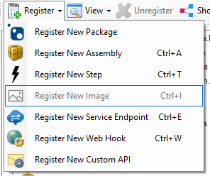
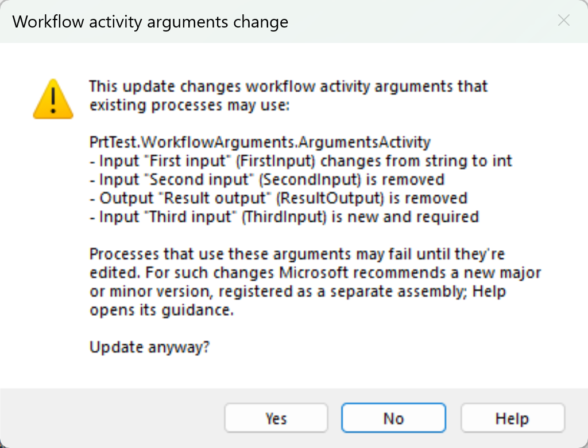
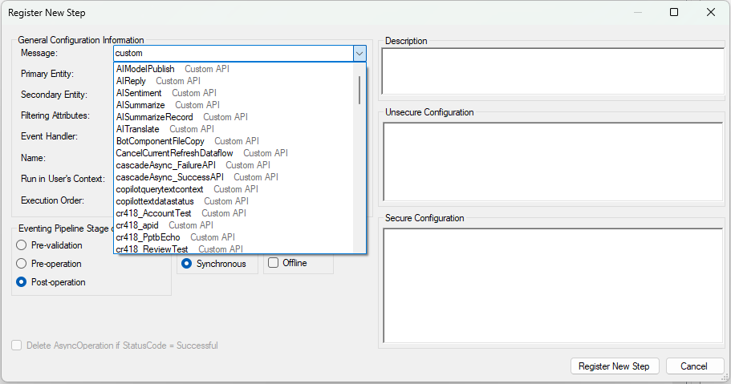
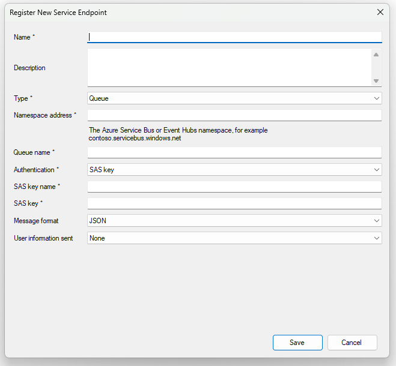
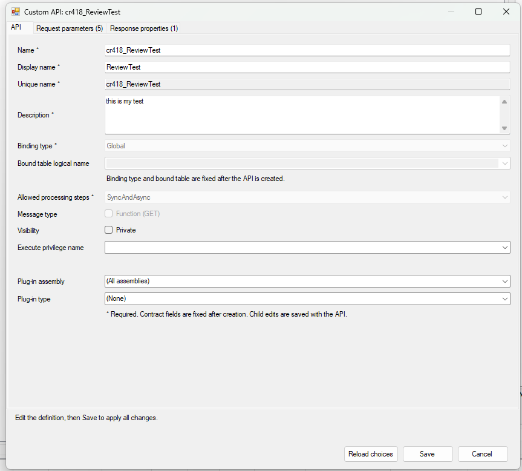
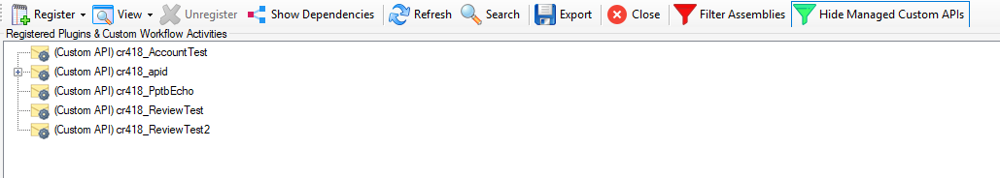

# Plugin Registration for XrmToolBox

Register and manage plug-ins, custom workflow activities, steps, images, webhooks, service endpoints and Custom APIs in Microsoft Dataverse and Dynamics 365, from inside [XrmToolBox](https://www.xrmtoolbox.com/).

Questions, bugs and ideas: [GitHub Issues](https://github.com/imranakram/PluginRegistration/issues)

## Getting started

1. In XrmToolBox, open the **Tool Library**, search for **Plugin Registration** and install it.
2. Connect to an environment and open the tool. The tree shows everything registered in the environment, grouped by assembly.
3. Use the **Register** menu, or right-click a node in the tree, to register something new. Select a node to see its properties, and use **Update** or **Unregister** to change or remove it.

Try changes in a development or test environment before making them in production.

## Features

### Plug-in assemblies and packages
- Register an assembly and choose which of its [plug-ins](https://learn.microsoft.com/power-apps/developer/data-platform/plug-ins) and [custom workflow activities](https://learn.microsoft.com/power-apps/developer/data-platform/workflow/workflow-extensions) to register, with sandbox isolation and database storage. On-premises environments can also store the assembly on disk or in the GAC.
- Update an assembly with a new build and register any plug-ins added to it. A build that no longer contains a registered plug-in is refused until that plug-in is unregistered.
- Updating an assembly also brings in new input and output arguments of its custom workflow activities. Microsoft [recommends a new assembly version](https://learn.microsoft.com/power-apps/developer/data-platform/workflow/workflow-extensions#manage-changes-to-custom-workflow-activities) when arguments change, but updating in place is often the practical choice, especially when plug-ins share the assembly. So the tool lets you, after a warning: if an argument is removed, changes type or becomes required, it lists those changes and you choose to update anyway or cancel. Added optional arguments go through without a question.

- Register and update [plug-in packages](https://learn.microsoft.com/power-apps/developer/data-platform/build-and-package): NuGet packages that carry the assemblies your plug-ins depend on, so you don't have to merge them into one assembly.
- Link a [managed identity](https://learn.microsoft.com/power-platform/admin/set-up-managed-identity) to an assembly or package, and create, edit or delete identities (Dataverse online only). Plug-ins can then get tokens for Azure resources without a stored secret.

### Steps and images
- Register steps on a message and table, with filtering attributes, stage, synchronous or asynchronous execution, execution order, the user to run as, and secure and unsecure configuration. Microsoft's [Register a plug-in](https://learn.microsoft.com/power-apps/developer/data-platform/register-plug-in) explains each field, and the [event framework](https://learn.microsoft.com/power-apps/developer/data-platform/event-framework) explains the stages.
- **Message** and **Primary Entity** are searchable: type any part of a name. Custom API messages are marked *Custom API*, so typing "custom api" lists them all. A primary entity of *none* means every table on a message like Update, and no table on a message that has none, such as a global Custom API.

- **Run in User's Context** runs the step as another user; see [impersonate a user](https://learn.microsoft.com/power-apps/developer/data-platform/impersonate-a-user). Asynchronous steps run after the operation in the [asynchronous service](https://learn.microsoft.com/power-apps/developer/data-platform/asynchronous-service), always in Post-operation.
- Enable or disable a single step, or all steps of an assembly at once.
- Add pre-images and post-images with the columns they should hold. Pick only the columns your plug-in reads: an image with all columns slows every operation the step runs on.
- Only [some messages support images](https://learn.microsoft.com/power-apps/developer/data-platform/register-plug-in#messages-that-support-entity-images): Create, Update, Delete, Assign, SetState, Merge and a few others. **Register New Image** is greyed out on a step on any other message, Custom API messages included, and its tooltip says why. A step on Create can only have a post-image, and one on Delete only a pre-image.

### Webhooks and service endpoints
- Register [webhooks](https://learn.microsoft.com/power-apps/developer/data-platform/use-webhooks) with HTTP header, webhook key or query string authentication, and register steps on them.
- Register [Azure service endpoints](https://learn.microsoft.com/power-apps/developer/data-platform/azure-integration): Service Bus queues and topics, Event Hubs, one-way, two-way and REST relays, and Event Grid, with a SAS key, SAS token or access key. Register steps on them to send the execution context to Azure.

### Custom APIs
[Custom APIs](https://learn.microsoft.com/power-apps/developer/data-platform/custom-api) are your own messages, with a plug-in that does the work and request parameters and response properties that callers use. Microsoft's [Custom API tables](https://learn.microsoft.com/power-apps/developer/data-platform/custom-api-tables) describe each field.
- Create, edit and delete Custom APIs with their request parameters and response properties. A new API goes into an unmanaged solution you pick or create, with the publisher's prefix on its unique name. Fields that Dataverse fixes after creation are read-only, and managed APIs can't be changed or deleted.

- The bound table, execute privilege, plug-in assembly and plug-in type are searchable lists. Assemblies show their version, so two with the same name can be told apart. **Reload choices** reads the tables and privileges again, for example after adding a table.
- **View > Display by Custom API** (Ctrl+Shift+C) lists the Custom APIs, with or without steps, and the steps registered on each one beneath it. The **Hide Managed Custom APIs** toolbar button, shown in that view, hides the managed APIs, mostly Microsoft's. It's on by default.

- Other plug-ins can register steps on a Custom API's message, private APIs included, as far as the API's **Allowed Custom Processing Step Type** allows. When it's *None*, the message isn't offered. When it's *Async Only*, the step is fixed to asynchronous Post-operation, with a note saying why.
- **Add to Solution** adds an API with all its parameters and properties in one go.

### Finding and housekeeping
- Display the tree by package, assembly, entity, message or Custom API, search it, and filter out managed assemblies or assemblies whose names start with given terms.
- Add components to a [solution](https://learn.microsoft.com/power-apps/maker/data-platform/solutions-overview), check for an unmanaged [active layer](https://learn.microsoft.com/power-platform/alm/solution-layers-alm) and remove it, and show an assembly's, plug-in's or step's dependencies.
- Export assemblies, steps, images, webhooks and service endpoints to CSV or Excel.
- Unregister an assembly with everything registered on it, after a check that it isn't part of a plug-in package.

## Where it comes from

This tool started life as the **Plug-in Registration Tool sample** that Microsoft published with the **Microsoft Dynamics CRM 2011 SDK** in 2010. That sample came with full source code and showed how to use the SDK's registration classes. In 2015 the source was ported to XrmToolBox, and the community has maintained and extended it since: plug-in packages, Custom APIs, managed identities, webhooks and service endpoints have all been added along the way.

Source files that still contain Microsoft's sample code keep the original Microsoft copyright header. Microsoft now ships its own, separately developed Plug-in Registration Tool through the Power Platform CLI ([`pac tool prt`](https://learn.microsoft.com/power-platform/developer/cli/reference/tool)). This project is not affiliated with Microsoft.

## Contributing

Bug reports, ideas and pull requests are welcome through [GitHub Issues](https://github.com/imranakram/PluginRegistration/issues).

The tool is a .NET Framework 4.8 class library. Open `PluginRegistration.sln` in Visual Studio and build. To try a build, close XrmToolBox and copy `Xrm.Sdk.PluginRegistration.dll` from `Xrm.Sdk.PluginRegistration\bin\Debug` to `%APPDATA%\MscrmTools\XrmToolBox\Plugins`.

### Running the tests

The unit tests run without any setup. The integration tests (category `Integration`) register a test plug-in assembly in a real Dataverse environment through the tool's own registration code. They create steps, an image, a webhook, a service endpoint (with a fake Service Bus address, so nothing is ever sent) and a Custom API with a plug-in handler, check that each one loads back and runs, and then unregister everything again. Use a developer or trial environment, never production.

1. Copy `Xrm.Sdk.PluginRegistration.Tests\testbench.example.json` to `testbench.local.json` in the same folder and fill in a client-secret connection string. That file is gitignored. You can also set `PRT_TESTBENCH` (the path to such a file) or `PRT_TESTBENCH_CONNECTION` (the connection string itself). The Custom API tests create temporary solutions under the `publisher` in the file (its unique name, or `PRT_TESTBENCH_PUBLISHER`), or under the default solution's publisher when that is not set or not found.
2. Build the solution and run the tests from Test Explorer, or with `vstest.console.exe Xrm.Sdk.PluginRegistration.Tests.dll /TestCaseFilter:"TestCategory=Integration"`.

Without a configuration the integration tests are skipped, so CI only runs the unit tests.

## License

[MIT](LICENSE). Portions are derived from the Microsoft Dynamics CRM SDK code samples; see the license file for details.
