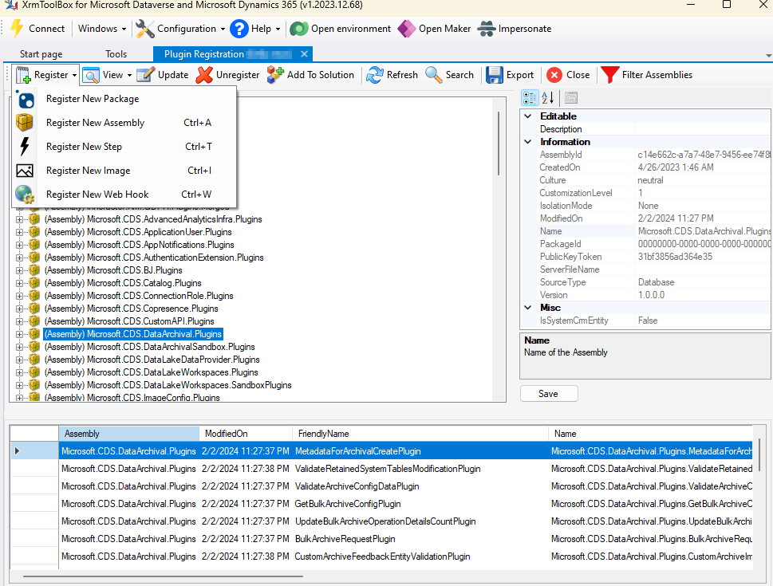

# Plugin Registration for XrmToolBox

Register and manage plug-ins, custom workflow activities, steps, images, webhooks, service endpoints and Custom APIs in Microsoft Dataverse and Dynamics 365, from inside [XrmToolBox](https://www.xrmtoolbox.com/).

Questions, bugs and ideas: [GitHub Issues](https://github.com/imranakram/PluginRegistration/issues)

## Getting started

1. In XrmToolBox, open the **Tool Library**, search for **Plugin Registration** and install it.
2. Connect to an environment and open the tool. The tree shows everything registered in the environment, grouped by assembly.
3. Use the **Register** menu, or right-click a node in the tree, to register something new. Select a node to see its properties, and use **Update** or **Unregister** to change or remove it.

Try changes in a development or test environment before making them in production.

## Features

### Plug-in assemblies and packages
- Register an assembly and choose which of its plug-ins and custom workflow activities to register, with sandbox isolation and database storage. On-premises environments can also store the assembly on disk or in the GAC.
- Update an assembly with a new build and register any plug-ins added to it. A build that no longer contains a registered plug-in is refused until that plug-in is unregistered.
- Register and update plug-in packages (NuGet packages with dependent assemblies).
- Link a managed identity to an assembly or package, and create, edit or delete identities (Dataverse online only).

### Steps and images
- Register steps on a message and table, with filtering attributes, stage, synchronous or asynchronous execution, execution order, the user to run as, and secure and unsecure configuration.
- Enable or disable a single step, or all steps of an assembly at once.
- Add pre-images and post-images with the columns they should hold.

### Webhooks and service endpoints
- Register webhooks with HTTP header, webhook key or query string authentication, and register steps on them.
- Register Azure service endpoints: Service Bus queues and topics, Event Hubs, one-way, two-way and REST relays, and Event Grid, with a SAS key, SAS token or access key. Register steps on them to send the execution context to Azure.

### Custom APIs
- Create, edit and delete Custom APIs with their request parameters and response properties, in an unmanaged solution you choose.

### Finding and housekeeping
- Display the tree by package, assembly, entity or message, search it, and filter out managed assemblies or assemblies whose names start with given terms.
- Add components to a solution, check for an unmanaged active layer and remove it, and show an assembly's, plug-in's or step's dependencies.
- Export assemblies, steps, images, webhooks and service endpoints to CSV or Excel.
- Unregister an assembly with everything registered on it, after a check that it isn't part of a plug-in package.

## Where it comes from

This tool started life as the **Plug-in Registration Tool sample** that Microsoft published with the **Microsoft Dynamics CRM 2011 SDK** in 2010. That sample came with full source code and showed how to use the SDK's registration classes. In 2015 the source was ported to XrmToolBox, and the community has maintained and extended it since: plug-in packages, Custom APIs, managed identities, webhooks and service endpoints have all been added along the way.

Source files that still contain Microsoft's sample code keep the original Microsoft copyright header. Microsoft now ships its own, separately developed Plug-in Registration Tool through the Power Platform CLI (`pac tool prt`). This project is not affiliated with Microsoft.

## Contributing

Bug reports, ideas and pull requests are welcome through [GitHub Issues](https://github.com/imranakram/PluginRegistration/issues).

The tool is a .NET Framework 4.8 class library. Open `PluginRegistration.sln` in Visual Studio and build. To try a build, close XrmToolBox and copy `Xrm.Sdk.PluginRegistration.dll` from `Xrm.Sdk.PluginRegistration\bin\Debug` to `%APPDATA%\MscrmTools\XrmToolBox\Plugins`.

### Running the tests

The unit tests run without any setup. The integration tests (category `Integration`) register a test plug-in assembly in a real Dataverse environment through the tool's own registration code. They create steps, an image, a webhook, a service endpoint (with a fake Service Bus address, so nothing is ever sent) and a Custom API with a plug-in handler, check that each one loads back and runs, and then unregister everything again. Use a developer or trial environment, never production.

1. Copy `Xrm.Sdk.PluginRegistration.Tests\testbench.example.json` to `testbench.local.json` in the same folder and fill in a client-secret connection string. That file is gitignored. You can also set `PRT_TESTBENCH` (the path to such a file) or `PRT_TESTBENCH_CONNECTION` (the connection string itself). The Custom API tests create temporary solutions under the `publisher` in the file (its unique name, or `PRT_TESTBENCH_PUBLISHER`), or under the default solution's publisher when that is not set or not found.
2. Build the solution and run the tests from Test Explorer, or with `vstest.console.exe Xrm.Sdk.PluginRegistration.Tests.dll /TestCaseFilter:"TestCategory=Integration"`.

Without a configuration the integration tests are skipped, so CI only runs the unit tests.

## License

[MIT](LICENSE). Portions are derived from the Microsoft Dynamics CRM SDK code samples; see the license file for details.
